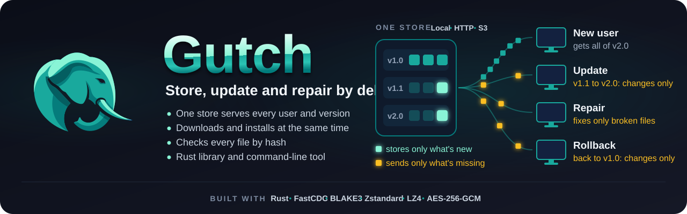

<p align="center">
  
</p>

# Gutch

Gutch is a deduplicating store and installer for folder trees, written in
Rust as a library and a command-line tool. You capture each version of a
folder into a repository, which keeps every piece of content once, so a new
version costs only the bytes that changed. Any stored version can then be
installed, checked and repaired:

```sh
# Create an empty repository in the folder ./my-repo
gutch-cli repo init --repo ./my-repo

# Store the folder ./builds/1.0; this prints the new snapshot's ID
gutch-cli snapshot capture --repo ./my-repo --source ./builds/1.0 --tag version=1.0

# Install that snapshot into ./installed-app, then check it
gutch-cli installation reconstruct --repo ./my-repo --snapshot <SNAPSHOT_ID> --destination ./installed-app
gutch-cli installation verify --repo ./my-repo --snapshot <SNAPSHOT_ID> --destination ./installed-app
```

## Where it fits

| You're building | Fit | What Gutch does |
| --- | --- | --- |
| A game or app launcher | ✅ Good | Updates download only what changed. Repair rewrites only broken files. |
| A tool that keeps several versions installed | ✅ Good | Content the versions share is stored once, as in the [launcher sample](examples/launcher_sample). |
| A build archive | ✅ Good | Any old build comes back exactly. |
| An app that ships from your own server or S3 | ✅ Good | You embed the Rust library and plug in your storage, as [`examples/s3_app`](examples/s3_app) does. |
| Backups of file contents | 🟡 Partial | Restores are fast and checked, but old versions are not pruned for you. |
| Full system backups | ❌ Poor | Owners, timestamps, extended attributes and hard links are not kept. |

Gutch is a library first, and `gutch-cli` is a thin layer over it.
Repositories sync with a server your application provides, so the
application keeps control of its own accounts and access rules.

## Performance

[](https://github.com/icauro/Gutch-Benchmarks)

Think of a game sold through a store such as Steam or the Epic Games Store.
The developer uploads each build once, and players download it millions of
times: they install it, update it with every patch and repair it when files
are damaged. All three run Gutch's install engine, the part behind
`installation reconstruct`, and that is what Gutch is optimized for. Against
Restic, Kopia, Borg, Rustic and Plakar, a fresh install is 2.2–4.6× faster and
a repair 2.4–8× faster (29× against Plakar).

Capture is the developer's side. It runs once per build, so it matters less,
but it is still quick. Chunks are hashed with BLAKE3, and content the
repository already holds is skipped before it is compressed. Gutch captures
faster than all of the tools above except Kopia, which is about 1.2× quicker,
and its repository ends up between 3.7% smaller and 0.2% larger than theirs.

The [benchmarks](https://github.com/icauro/Gutch-Benchmarks) are public and
run on GitHub Actions, so anyone can rerun them. Each one compares Gutch with
a single other tool. The other tools offer fewer settings than Gutch, so no
one baseline fits all of them; instead, Gutch is set to match each tool as
closely as that tool allows.

### Gutch maximizes throughput

<p align="center">
  <a href="_docs/assets/install_profile.svg"></a>
</p>

In this example, Gutch installs Blender 5.1 for Windows (977 MB in 6,368
files, stored as 380 MB) in 0.65 s, checking every file before the folder
goes live. Copying the same folder uncompressed with robocopy takes 0.77 s.

The timeline above shows why. Unpacking and checking take very little time;
almost all of it goes to writing files, so the disk sets the speed. With the
same thread limit, 4 or 8, Gutch and robocopy both take about 0.7 s.

<sub>AMD Ryzen 9 7900 (12 cores), KIOXIA Exceria G2 NVMe SSD, Windows 11,
default settings. Median of three runs, with the store already in memory and
a 10-second pause between runs.</sub>

## How it works

Gutch has two halves. Capture turns a folder into a snapshot inside a
repository. The install engine turns a snapshot back into a folder, and it
does this for a fresh install, an update and a repair alike. Each snapshot's
ID is derived from its content, so any installation can be checked against
it.

<p align="center">
  
</p>

### Capture

1. Each file is cut into chunks of about 128 KiB at points chosen by the
   content, so inserting a few bytes near the start of a file leaves the
   chunks after it unchanged.
2. Each chunk is named by its BLAKE3 hash.
3. Chunks the repository already holds are not stored again.
4. New chunks are compressed with zstd and packed into 8 MiB bundles.
5. The snapshot is saved under its content-derived ID, so capturing the same
   folder twice changes nothing.

| Option | Default | Choose it to |
| --- | --- | --- |
| `--chunk-preset` | `128KiB` | Find more shared content with smaller chunks, at the cost of a larger index |
| `--compression-algorithm` | `zstd` | Trade size for speed with `lz4`, or store uncompressed with `none` |
| `--bundle-preset` | `8MiB` | Use bundles from 4 MiB to 128 MiB |
| `--storage-mode` | `bundled` | Keep each chunk in its own file with `loose-chunks`, so installs fetch only what they use at the cost of many more requests ([compare](_docs/03_capturing_snapshots.md#bundled-or-loose-chunks)) |
| `repo init --encrypt` | off | Encrypt the repository with AES-256-GCM, using a password or key file |
| `repo init --filesystem` | none | Refuse file names that would break on the systems you ship to |

[Capturing snapshots](_docs/03_capturing_snapshots.md#storage-options) has
every option.

### Install and update

1. Gutch lists the bundles the snapshot needs. For an update, it first looks
   for content it can copy from the old installation instead.
2. Bundles come from the repository, or are [downloaded over
   HTTP(S)](_docs/04_installing_snapshots.md#download-while-reconstructing)
   while earlier ones are still being unpacked.
3. Each bundle is decompressed once, on all cores, and every chunk in it is
   written straight to each file and offset that uses it.
4. A file is hashed the moment its last chunk lands, while other files are
   still being written.
5. The tree is built in a staging folder next to the destination and swapped
   in only after every file checks out. If anything fails, the old
   installation is still there, untouched.

| Option | Default | Choose it to |
| --- | --- | --- |
| `--reuse-snapshot`, `--reuse-dir` | none | Update from an installed version, copying what is unchanged |
| `--fetch` | off | Download the snapshot while installing |
| `--jobs` | all cores | Limit the worker threads |
| `--memory-budget-mib` | 25% of RAM | Limit the working memory |
| `--staging-dir` | next to the destination | Build the tree somewhere else on the same disk |

### Repair

1. Every file is hashed and compared with the snapshot.
2. Only the bundles that missing or damaged files need are read.
3. Those files are replaced one at a time; healthy files are not touched. If
   repair is interrupted, run it again to finish.

Extra files in the folder are kept unless you pass `--remove-extra-files`.

### What Gutch leaves out

Gutch stores file contents, symbolic links and two flags, executable and
read-only. It does not store owners, timestamps or extended attributes,
because restoring them would add work for every file on every install.
Encryption and profiling cost nothing unless you turn them on.

## Getting Gutch

Download the `gutch-cli` executable for Linux or Windows on x86-64 or ARM64
from the [latest release](https://github.com/icauro/Gutch/releases/latest).
`SHA256SUMS` in the same release checks the download, and
`gutch-cli licenses` prints the licenses of everything built into it. To
build from source with Rust 1.100 or newer:

```sh
cargo build --release -p gutch-cli
```

## Documentation

The [user guide](_docs/README.md) starts with
[getting started](_docs/01_getting_started.md) and covers every command. To
use Gutch from your own Rust application, see
[embedding Gutch](_docs/08_embedding_gutch.md). To work on Gutch itself, see
the [developer guide](_dev_guide/README.md).

## License

Original project code is [MIT licensed](LICENSE). Included third-party source
keeps its own terms; see [third-party notices](THIRD_PARTY_NOTICES.md).
