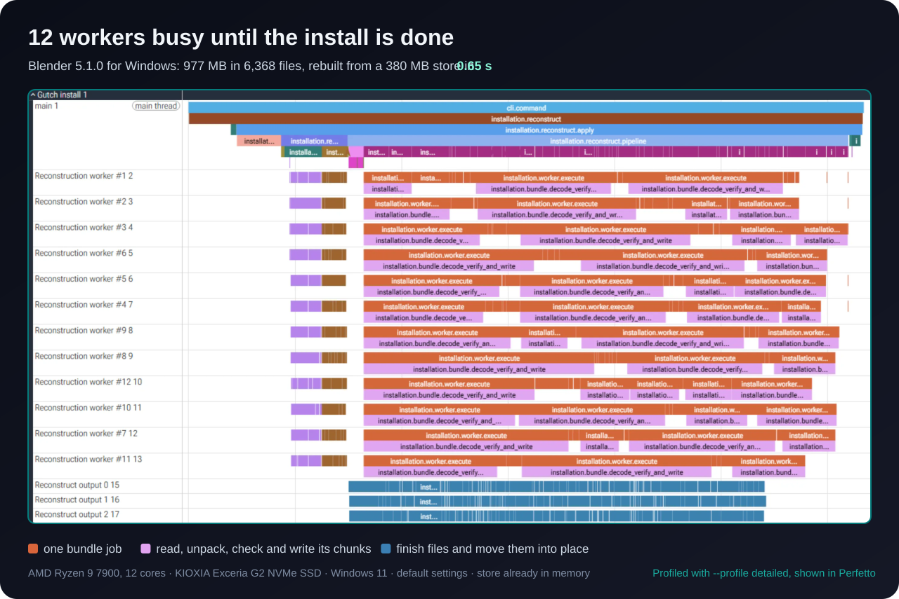
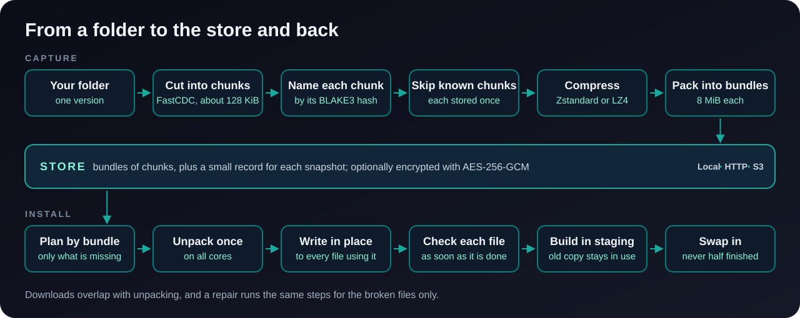

<p align="center">
  
</p>

# Gutch

Gutch is a deduplicating store and installer for folder trees, written in
Rust as a library and a command-line tool. You capture each version of a
folder into a repository, which keeps every piece of content once, so a new
version costs only the bytes that changed. Any stored version can then be
installed, checked and repaired:

```sh
# Create an empty repository in the folder ./my-repo
gutch-cli repo init --repo ./my-repo

# Store the folder ./builds/1.0; this prints the new snapshot's ID
gutch-cli snapshot capture --repo ./my-repo --source ./builds/1.0 --tag version=1.0

# Install that snapshot into ./installed-app, then check it
gutch-cli installation reconstruct --repo ./my-repo --snapshot <SNAPSHOT_ID> --destination ./installed-app
gutch-cli installation verify --repo ./my-repo --snapshot <SNAPSHOT_ID> --destination ./installed-app
```

Repair rewrites only the files that are missing or damaged. An install can
also [download the snapshot over HTTP(S)](_docs/04_installing_snapshots.md#download-while-reconstructing)
while it writes, a repository can be encrypted with a password or key file,
and capture can refuse file names that would break on the systems you ship to.

## Performance

[](https://github.com/icauro/Gutch-Benchmarks)

Think of a game sold through a store such as Steam or the Epic Games Store.
The studio uploads each build once, and players download it millions of times:
they install it, update it with every patch and repair it when files are
damaged. All three run the same command, `installation reconstruct`, and that
is the command Gutch is optimized for. Against Restic, Kopia, Borg, Rustic and
Plakar, a fresh install is 2.2–4.6× faster and a repair 2.4–8× faster (29×
against Plakar).

Capture is the studio's side. It runs once per build, so it matters less,
but it is still quick. Chunks are hashed with BLAKE3, and content the
repository already holds is skipped before it is compressed. Gutch captures
faster than all of the tools above except Kopia, which is about 1.2× quicker,
and its repository ends up between 3.7% smaller and 0.2% larger than theirs.

Every comparison runs both tools on the same machine, with chunk sizes,
compression, encryption and worker counts matched as closely as each tool
allows, and checks every restored file with SHA-256.
[Gutch Benchmarks](https://github.com/icauro/Gutch-Benchmarks) has the
method, the raw results and the differences that remain between the tools,
so anyone can run it again.

### One install, up close

<p align="center">
  <a href="_docs/assets/install_profile.svg"></a>
</p>

Gutch installs Blender 5.1 for Windows, 977 MB in 6,368 files stored as
380 MB, in 0.65 s and checks every file before the folder goes live. Copying
the same folder uncompressed with robocopy takes 0.77 s. Both ran with
default settings on an AMD Ryzen 9 7900 (12 cores) with a KIOXIA Exceria G2
NVMe SSD and Windows 11. Unpacking and checking are thin
slivers; nearly all the time goes to writing files, so the disk sets the
pace. Limited to 4 or 8 threads, Gutch takes about 0.7 s, level with robocopy
on the same thread count. Each figure is the median of three runs with the
store already in memory and a 10-second pause between runs.

## How it works

<p align="center">
  
</p>

Capture cuts each file into chunks of about 128 KiB at points chosen by the
content, so inserting a few bytes near the start of a file leaves the chunks
after it unchanged. Each chunk is named by its BLAKE3 hash, which is several
times faster to compute than the SHA-256 most backup tools use. Chunks the
repository already holds are skipped; new ones are compressed and packed into
8 MiB bundles. A snapshot's ID is derived from its content, so capturing the
same folder twice changes nothing, and any installation can be checked
against that ID.

Install works bundle by bundle instead of file by file. Each bundle is read
and unpacked once, on all cores, and every chunk in it goes straight to each
file and offset that uses it. A file is checked the moment its last chunk
lands, while other files are still being written, and downloads overlap with
unpacking. The whole tree is built in a staging folder next to the
destination and swapped in only after every file checks out. If anything
fails, the old installation is still there, untouched.

Repair first finds the files that are missing or damaged, then reads only the
bundles those files need. An update can copy matching content from the old
installation instead of the repository, so only the differences are
downloaded and unpacked.

When capture speed and install speed pull apart, install wins. That is why
Gutch keeps only file contents, symbolic links and the executable and
read-only flags: there are no owners, timestamps or extended attributes to
apply file by file. Encryption (AES-256-GCM), loose-chunk storage and
profiling are off by default and add no work while off.

## Where it fits

Gutch suits programs that put the same large folders on many machines, again
and again: a launcher that updates a game in place, or a package manager that
keeps several versions of a tool side by side. A build archive gets the same
benefit, since every old build comes back exact while sharing storage with
the rest.

It is a poor fit for system backups. It has no retention schedules, and it
drops owners, permissions beyond the two flags, timestamps, extended
attributes and hard links.

Gutch is a library first, and `gutch-cli` is a thin layer over it. A
repository lives in a local folder. To keep one in S3-compatible storage or
another object store, implement a small storage interface;
[`examples/s3_app`](examples/s3_app) is a complete S3 app. Repositories sync
with a server your application provides, and the application keeps control of
its own accounts and access rules.

## Getting Gutch

Download the `gutch-cli` executable for Linux or Windows on x86-64 or ARM64
from the [latest release](https://github.com/icauro/Gutch/releases/latest).
`SHA256SUMS` in the same release checks the download, and
`gutch-cli licenses` prints the licenses of everything built into it. To
build from source with Rust 1.100 or newer:

```sh
cargo build --release -p gutch-cli
```

## Documentation

The [user guide](_docs/README.md) starts with
[getting started](_docs/01_getting_started.md) and covers every command. To
use Gutch from your own Rust application, see
[embedding Gutch](_docs/08_embedding_gutch.md). To work on Gutch itself, see
the [developer guide](_dev_guide/README.md).

## License

Original project code is [MIT licensed](LICENSE). Included third-party source
keeps its own terms; see [third-party notices](THIRD_PARTY_NOTICES.md).
