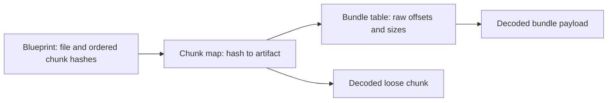

# Gutch Binary File Layouts

Status: Current

Scope: Persisted artifact, chunk-index, and snapshot-blueprint bytes

Verified: 2026-09-11

## Reading the Layouts

The definitions below are serialized layouts, not Rust memory structs. Fields
appear in the listed order with no alignment padding. Integers are unsigned,
fixed-width, and little-endian. Array counts describe on-disk repetitions;
they do not add implicit length fields.

```text
u8  = 1 byte       u16 = 2 bytes
u32 = 4 bytes      u64 = 8 bytes
Hash32 = byte[32]  // binary BLAKE3 digest
Hex64  = byte[64]  // lowercase ASCII hexadecimal digest
String = { length: u32, utf8: byte[length] }
```

String lengths count UTF-8 bytes, not characters. Rust `String`, `Vec`, and map
allocation overhead is not part of these file sizes. KiB and MiB use powers of
1024. Size formulas exclude filesystem allocation, filenames, JSON documents,
and transport overhead unless explicitly included.

## Files and Their Roles

| Path under a repository | Contents | Identity or lookup role |
|---|---|---|
| `snapshots/<id>/snapshot_blueprint.gtcbin` | File tree and ordered chunk references | Which chunks reconstruct each file |
| `chunk_map.gtcbin` | Parallel arrays describing indexed chunks | Which artifact contains a chunk; no chunk offsets |
| `bundles/<first-two-id-characters>/<id>` | One encoded payload plus chunk table | Chunk boundaries within that bundle |
| `chunks/<first-two-hash-characters>/<hash>` | One encoded raw chunk | Loose artifact named by the raw chunk hash |
| `repo_metadata.json` | JSON, including packaging profile | Supplies compression settings required by artifact readers |



Blueprint references repeat when files reuse a chunk. The chunk map has one
entry per indexed chunk hash. A bundle table describes the chunks physically
stored in that bundle. These are different scopes of metadata.

## Bundles

Bundles use the same outer layout with `none`, `zstd`, or `lz4` compression.
The current reader accepts bundle-level compression only: all chunks form one
concatenated raw stream, encoded together. There is no separate codec frame per
chunk inside a bundle.

```text
Bundle {
    magic:              byte[8] = "ZNRBNDL\0"
    chunk_count:        u32 = N
    payload:            byte[C]
    footer: {
        chunk_count:    u32 = N
        entries:        BundleEntry[N]
    }
    footer_length:      u64 = 4 + 64*N
    footer_magic:       byte[8] = "ZNRFOOT\0"
    bundle_id:          Hex64
}

BundleEntry {
    chunk_hash:         Hash32  // 32 bytes
    raw_size:           u64     //  8 bytes
    compressed_size:    u64     //  8 bytes; accounting estimate
    compressed_offset:  u64     //  8 bytes; always zero
    raw_offset:         u64     //  8 bytes; in decoded stream
}                              // 64 bytes total
```

Here `C` is the encoded payload length, including codec framing when compressed.

| Region | Start offset | Length |
|---|---:|---:|
| Header | 0 | 12 |
| Payload | 12 | C |
| Footer count and entries | 12 + C | 4 + 64N |
| Footer length | 16 + C + 64N | 8 |
| Footer magic | 24 + C + 64N | 8 |
| Trailing ID | 32 + C + 64N | 64 |

**Exact file size: `C + 64N + 96` bytes.** Given total file size `S`, the reader
finds `footer_length` at `S - 80` and the footer at
`S - 80 - footer_length`. The footer length excludes the trailer and trailing ID.

The ID is BLAKE3 over every byte before the trailing 64-byte ID, including the
header, payload, footer, footer length, and footer magic. The filename and
trailing ASCII ID repeat that digest. It is not the hash of the complete file
including its own ID. Chunk hashes instead cover each chunk's raw bytes.

`raw_offset` is the cumulative raw size of preceding entries. Because chunks
share one stream, `compressed_offset` is zero and cannot locate a chunk for a
compressed range read. `compressed_size` apportions `C` by raw size: each entry
except the last gets `floor(raw_size * C / total_raw_size)`; the last gets the
remaining bytes. The estimates sum to `C`, excluding outer bundle overhead.

The bundle has magic markers but no separate numeric format-version field,
compression-algorithm field, or repository identity. Its reader needs the
repository compression profile. A structurally empty bundle has no payload or
entries and occupies 96 bytes; ordinary capture packages newly required chunks.

## Loose Chunks and Compression Modes

```text
LooseChunkFile = Encode(raw_chunk_bytes)
```

There is no Gutch header, table, trailer, or embedded hash in a loose-chunk file.
Its path supplies the raw-content hash; the index supplies the expected raw size,
and the repository profile selects the decoder.

| Storage | `none` | `zstd` | `lz4` |
|---|---|---|---|
| Bundle payload | Concatenated raw chunks | One zstd stream over the concatenation | One LZ4 frame stream over the concatenation |
| Loose file | Raw bytes of one chunk | Encoded zstd stream for one chunk | Encoded LZ4 frame stream for one chunk |
| Gutch artifact overhead | Bundled: `64N + 96`; loose: zero | Same | Same |

Codec overhead is already included in the encoded length and is not a fixed
Gutch per-chunk constant. Compression level changes payload bytes, not the
outer schema. With `none`, encoded length equals raw length. Gutch does not
encrypt these files. Loose storage still requires the chunk map and blueprints;
zero artifact framing does not mean zero repository metadata.

## Chunk Map (`GTCI`, Binary Version 1)

The index is a **structure of arrays**, not repeated complete entry structs.
Every array uses the same index `i` to identify one chunk.

```text
ChunkMap {
    magic:              byte[4] = "GTCI"
    binary_version:     u16 = 1
    reserved:           u16 = 0
    chunk_count:        u64 = N
    format_version:     String
    updated_at:         String
    chunk_hashes:       Hash32[N]
    storage_modes:      u8[N]       // 0 = bundled, 1 = loose_chunks
    object_ids:         String[N]
    raw_sizes:          u64[N]
    compressed_sizes:   u64[N]
}
```

The writer traverses its `BTreeMap` in chunk-hash order when constructing the
arrays. The two strings after the fixed 16-byte header are the model format
version and update timestamp; the model version string is separate from the
binary version. Timestamp length varies, including when initially empty.

| Field for chunk `i` | Bundled | Loose chunks | Serialized bytes |
|---|---|---|---:|
| `chunk_hashes[i]` | Raw chunk digest | Raw chunk digest | 32 |
| `storage_modes[i]` | 0 | 1 | 1 |
| `object_ids[i]` | Bundle ID | Raw chunk hash repeated as hex | Normally 4 + 64 |
| `raw_sizes[i]` | Decoded chunk bytes | Decoded chunk bytes | 8 |
| `compressed_sizes[i]` | Bundle-table size estimate | Actual encoded loose-file length | 8 |

The internal name for `object_ids[i]` is `ChunkIndexEntry.bundle_id`, including
loose mode. Current capture writes the chunk hash into that field for loose
chunks; artifact resolution uses the chunk-hash key for the loose path.

For string byte lengths `F = len(format_version)`, `T = len(updated_at)`, and
`L_i = len(object_ids[i])`:

```text
chunk_map_bytes = 24 + F + T + sum(53 + L_i)
               = 24 + F + T + 117*N   // normal 64-character IDs
```

Both storage modes therefore use **117 bytes per indexed chunk** with current
IDs. Bundle IDs are repeated for each chunk; there is no shared object-ID
dictionary. The map contains no chunk offsets: bundle readers obtain them from
the bundle table. This corrects the shorthand description of the index as a
map to a bundle “and offset”; it maps to the artifact only.

Capture internally rebuilds mappings from bundle tables if the loaded index is
empty, including when the file is absent. A malformed existing index fails
loading before that fallback. The fallback does not scan loose chunks, is
read-only during store discovery, and is not a public recovery command or a
strict payload scrub.

## Snapshot Blueprint (`GTCT`, Binary Version 1)

Blueprints use a **tagged entry sequence**. Each file's chunk-reference array
immediately follows that file's fields; references are not stored as one global
array after all files.

```text
SnapshotBlueprint {
    magic:              byte[4] = "GTCT"
    binary_version:     u16 = 1
    reserved:           u16 = 0
    entry_count:        u32 = E
    chunk_ref_count:    u64 = R       // total across file entries
    entries:            Entry[E]
}                                   // 20-byte fixed header

FileEntry {
    kind:               u8 = 0
    path:               String
    size:               u64
    executable:         u8           // 0 or 1
    read_only:          u8           // 0 or 1
    full_file_hash:     Hash32
    chunk_count:        u32 = K
    chunks:             ChunkRef[K]
}
ChunkRef { chunk_hash: Hash32, raw_size: u64 }  // 40 bytes

DirectoryEntry {
    kind:               u8 = 1
    path:               String
    read_only:          u8           // 0 or 1
}
SymlinkEntry {
    kind:               u8 = 2
    path:               String
    target_path:        String
}
```

For UTF-8 path length `P`, target length `Q`, and a file's reference count `K`:

| Record | Exact bytes |
|---|---:|
| File | 51 + P + 40K |
| Directory | 6 + P |
| Symlink | 9 + P + Q |
| Complete blueprint | 20 + sum of all entry sizes |

References describe file content in order; a reference's file offset is the sum
of preceding raw sizes. The same chunk used twice costs two 40-byte references,
even though the repository stores the payload once. The source root itself is
not an entry. Symlink targets are normalized paths within the snapshot.

Blueprints are not compressed and have no trailing checksum field. Their
filesystem/content identity is validated when loading snapshot manifests. The
snapshot ID is not a hash of these binary bytes: it excludes chunk layout and
uses the separate installation-identity encoding. See
[snapshot identity](02_repository_snapshots_and_tags.md).

## Size Examples

Assume 64 distinct chunks, each exactly 128 KiB: 8 MiB of raw content. They occur
once in one file named `game.bin` (8 UTF-8 bytes). The index model version is
`1.0.0` (5 bytes) and its timestamp is 20 bytes. These are illustrative lengths,
not fixed chunk-count or timestamp guarantees.

| File or metadata | Bundled into one artifact | Loose chunks |
|---|---:|---:|
| Encoded payload total | C | Sum of 64 encoded lengths |
| Bundle table and fixed framing | 4,192 | 0 |
| Chunk map: `24 + 5 + 20 + 117*64` | 7,537 | 7,537 |
| Blueprint: `20 + 51 + 8 + 40*64` | 2,639 | 2,639 |
| Total excluding encoded payload and JSON | **14,368** | **10,176** |

With `none`, payload is 8,388,608 bytes. Total serialized bytes for these files
are **8,402,976 bundled** or **8,398,784 loose**, about 0.1713% or 0.1213% over
raw content. Actual disk usage for many loose files can be higher because of
filesystem allocation and directory metadata.

The bundle table alone costs `64 / average_raw_chunk_size`: about **0.0488%**
at 128 KiB or **6.25%** at 1 KiB, before the 96-byte fixed bundle cost. Those
percentages exclude the chunk map and blueprint. Strong compression reduces the
payload denominator but does not shrink these uncompressed metadata records.

Across repositories, count these separately:

- `64` bytes per physically stored bundle chunk, plus `96` per bundle;
- normally `117` bytes per indexed chunk, plus index strings/header;
- `40` bytes per file chunk reference, plus blueprint entries/headers.

Do not multiply every term by logical source size: deduplication reduces unique
stored chunks, while repeated references and separate snapshot blueprints remain.
The same payload can also exist in more than one physical representation.

## Reader Checks and Evidence

The writers emit zero reserved fields; the index and blueprint readers currently
read those fields without enforcing zero. Both reject unknown binary versions.
The blueprint reader rejects unknown kinds, invalid flags, mismatched reference
counts, and trailing bytes. The chunk-map reader rejects unknown storage modes
but does not perform the same trailing-byte rejection. Do not assume all formats
have identical validation.

Bundle parsing checks framing, counts, contiguous raw offsets, zero compressed
offsets, and size-estimate coverage. Full bundle identity verification and decoded
chunk checks are additional operations; parsing a footer alone is not a payload
integrity check. Loose reading checks decoded size and raw-content hash.

- [Index and blueprint serializers/readers](../../src/manifest/binary.rs)
- [In-memory content models](../../src/manifest/content.rs)
- [Bundle writer, footer, estimates, and identity verification](../../src/artifact/bundle.rs)
- [Compression adapters](../../src/artifact/compress.rs)
- [Loose decoding and artifact resolution](../../src/artifact/store.rs)
- [Index population and capture fallback](../../src/repo/chunk_index.rs)
- [Artifact path sharding](../../src/repo/paths.rs)
- [Installation identity encoding](../../src/repo/source_identity.rs)

These layouts describe the current serializers, not a Rust ABI or a promise of
compatibility with future prerelease formats.
